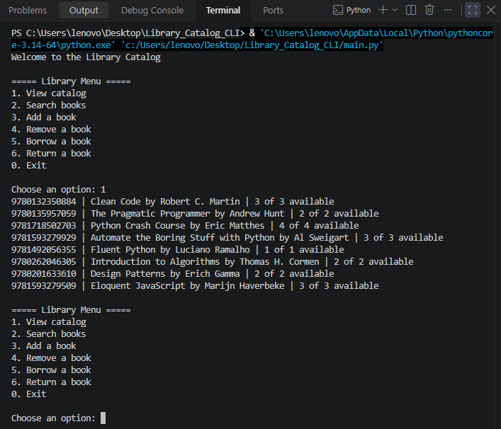
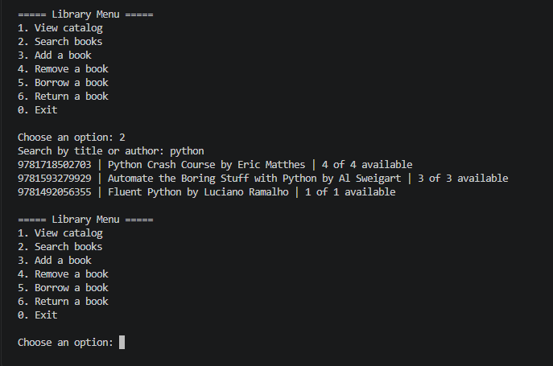
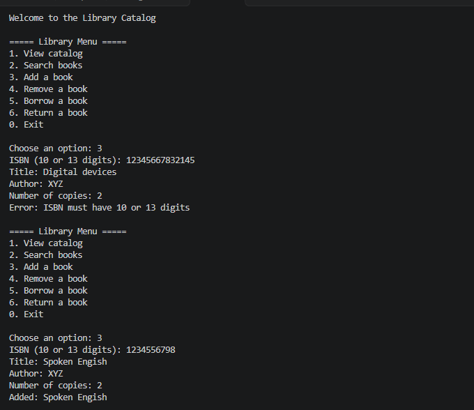
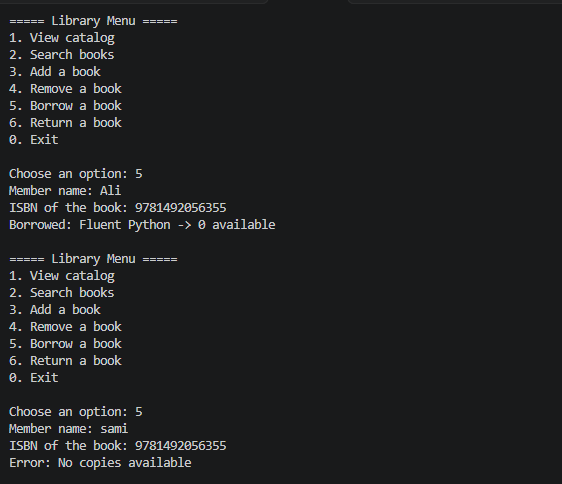
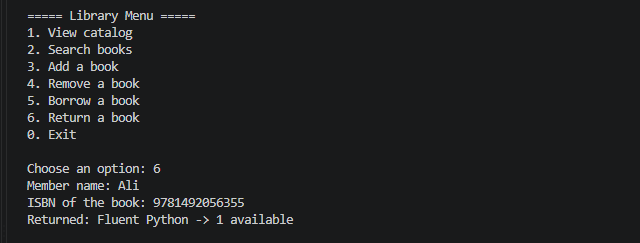
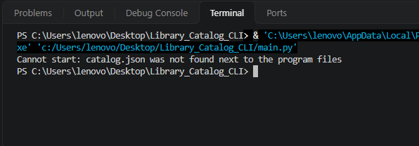

# Library Book Catalog CLI

A command line program in Python to manage a small library. You can add, search and remove books, and track which member has borrowed which book. The catalog is saved in a JSON file, so the data stays after the program is closed.

## Features

* Add books with ISBN, title, author and number of copies
* View the full catalog with the available copies
* Search by title or author (case insensitive, partial text)
* Remove a book (only when no copy is borrowed)
* Borrow and return books with member records
* A book cannot be issued when no copy is left
* Data is saved to `catalog.json` and loaded again at the next start
* Input validation with clear error messages

## Tech Stack

* Python 3
* Standard library only (`json`, `os`), nothing to install

## Project Structure

```
Library_Catalog_CLI/
├── main.py          menu and user input
├── library.py       business logic (add, search, remove, borrow, return)
├── storage.py       reading and saving catalog.json
├── catalog.json     sample catalog with 8 books
└── screenshots/
```

The logic is kept separate from the menu and from the file handling.

## Setup and Run

1. Install Python 3 from python.org
2. Download or clone this repository
3. Open a terminal in the project folder and run:

```
python main.py
```

## Menu Guide

1. View catalog: shows every book with its available copies
2. Search books: type part of a title or an author name
3. Add a book: enter ISBN, title, author and copies
4. Remove a book: enter the ISBN
5. Borrow a book: enter the member name and the ISBN
6. Return a book: enter the member name and the ISBN
0. Exit

## Validation Rules

* ISBN must have 10 or 13 digits and must be unique (spaces and dashes are ignored)
* Title and author cannot be empty
* Copies must be a positive whole number
* A member cannot borrow the same book twice
* A book with borrowed copies cannot be removed

## Error Handling

* A missing or damaged `catalog.json` shows a clear message instead of a crash
* Pressing Ctrl + C closes the program politely

## Sample Data

`catalog.json` comes with 8 programming books so the program can be tried at once.

## Screenshots

Catalog:



Search:



Adding a book and validation:



Borrow:



Return:



Error handling:



## Author

Samna Parveen, CodeNova Python Programming Internship, Batch 02